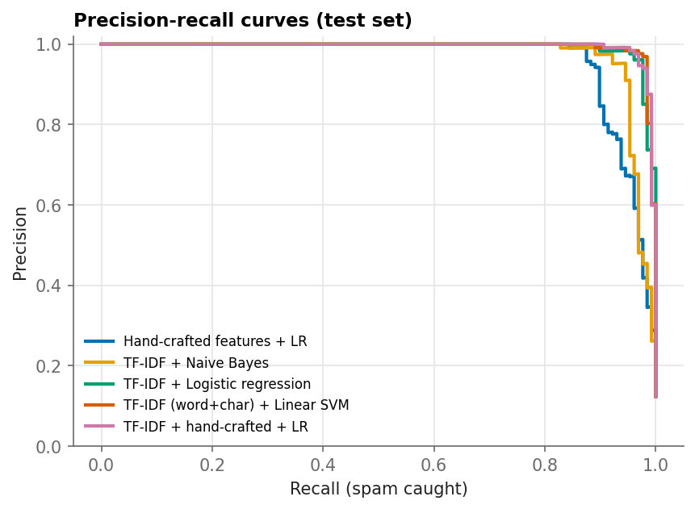
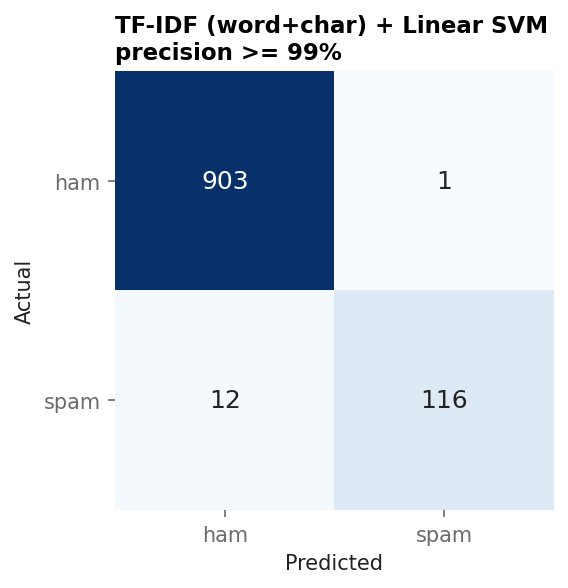
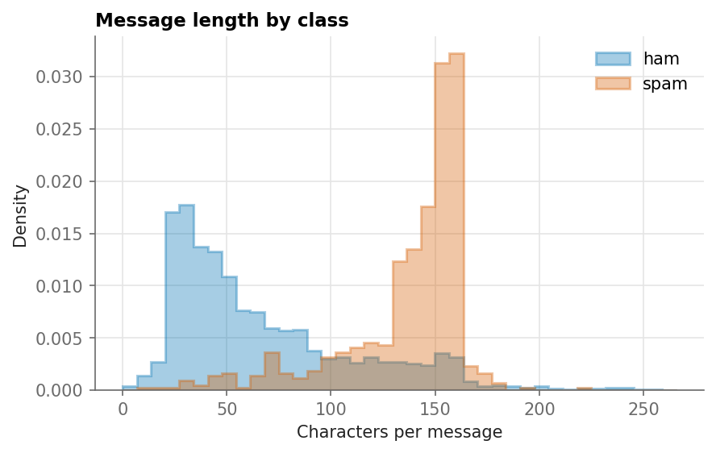
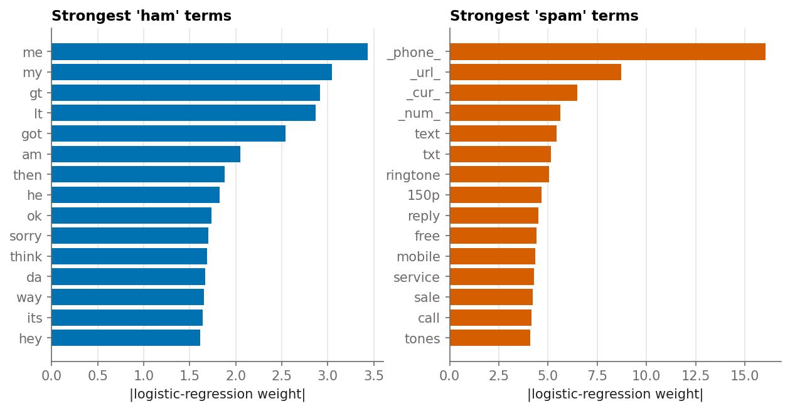

# SMS Spam Classifier

A natural-language-processing project: classic text classification with TF-IDF, a comparison of six models, a decision threshold tuned to a **business requirement** ("never block a real message"), and an error analysis.

## Problem

A messaging service wants to filter spam SMS. The two errors are not symmetric:

* A **spam message that slips through** is an annoyance.
* A **legitimate message that is blocked** may be an important one (a code, a family message) - much worse.

So instead of maximising accuracy, the project asks: *what is the highest share of spam we can catch while keeping at least 99% of blocked messages truly spam?*

## Dataset

[SMS Spam Collection](https://archive.ics.uci.edu/dataset/228/sms+spam+collection) (UCI): 5,574 English SMS messages labelled `ham` or `spam` (about 13% spam).

The pipeline downloads it automatically on first run. Offline? Put the file (`SMSSpamCollection`, `sms.tsv`, or the Kaggle `spam.csv`) into `data/raw/`.

> The collection contains hundreds of **exact duplicate** messages. They are removed *before* the train/test split - otherwise identical messages appear on both sides and inflate every score.

## Approach

1. **Text normalisation** - lower-casing; URLs, e-mails, phone numbers/short codes, other numbers and currency symbols become placeholder tokens (`_url_`, `_phone_`, `_num_`, `_cur_`), so the model learns *that* a message contains a link or a number, not which one.
2. **Features** - word 1-2-gram TF-IDF, character 2-5-gram TF-IDF, and eight hand-crafted style features (length, share of capitals and digits, exclamation marks, URL / currency / long-number flags).
3. **Models** (all are single scikit-learn `Pipeline`s, fitted on training folds only):
   majority-class baseline, hand-crafted features + LR, TF-IDF + Naive Bayes, TF-IDF + logistic regression, word+char TF-IDF + linear SVM, TF-IDF + hand-crafted + LR.
4. **Selection** - stratified 5-fold CV on the training set, ranked by PR-AUC (spam is the minority class).
5. **Operating point** - threshold with the highest recall subject to precision >= 99%, picked on out-of-fold training scores; the test set is used once.
6. **Error analysis & interpretability** - every misclassified test message is saved to `reports/errors.csv`; the strongest words per class are plotted.

## Project structure

```
sms-spam-classifier/
├── data/raw/              # dataset goes here (git-ignored)
├── src/
│   ├── data.py            # loading, cleaning, de-duplication, synthetic demo data
│   ├── text.py            # normalisation + hand-crafted features
│   ├── models.py          # the six model pipelines
│   ├── train.py           # CV, threshold, evaluation, figures, README update
│   ├── predict.py         # classify new messages from the command line
│   ├── plotting.py
│   └── report.py          # writes results into this README
├── tests/
└── reports/               # generated metrics, figures, errors.csv
```

## How to run

```bash
python -m venv .venv && source .venv/bin/activate     # Windows: .venv\Scripts\activate
pip install -r requirements.txt

python -m src.train          # trains, evaluates, fills the Results section below
python -m unittest           # run the tests
```

Classify messages with the trained model:

```bash
python -m src.predict "Congratulations! You have won a prize, call now" "see you at 6?"
python -m src.predict --file messages.txt
```

Options: `python -m src.train --target-precision 0.995 --seed 42 --cv 5`.
No internet? `python -m src.train --demo` uses **synthetic** template messages (smoke test only - its scores are meaningless).

## Results

> Written automatically by `src/train.py`, so every number comes from a real run.

<!-- RESULTS:START -->
_Generated by `python -m src.train` on 2026-10-22 (seed 42): 5,574 raw messages, 414 duplicates removed -> 5,160; spam share 12.4%; train/test = 80%/20%._

**Cross-validation on the training set (5-fold, spam = positive class)**

| Model | Precision | Recall | F1 | PR-AUC | ROC-AUC |
| --- | --- | --- | --- | --- | --- |
| Baseline (majority class) | 0.000 | 0.000 | 0.000 | 0.125 | 0.500 |
| Hand-crafted features + LR | 0.958 | 0.835 | 0.892 | 0.935 | 0.982 |
| TF-IDF + Naive Bayes | 0.983 | 0.916 | 0.949 | 0.978 | 0.991 |
| TF-IDF + Logistic regression | 0.976 | 0.897 | 0.935 | 0.979 | 0.992 |
| TF-IDF (word+char) + Linear SVM | 0.987 | 0.924 | 0.955 | 0.985 | 0.995 |
| TF-IDF + hand-crafted + LR | 0.985 | 0.916 | 0.949 | 0.974 | 0.995 |

Best model by PR-AUC: **TF-IDF (word+char) + Linear SVM**.

**Held-out test set (default `predict()`)**

| Model | Precision | Recall | F1 | PR-AUC | ROC-AUC |
| --- | --- | --- | --- | --- | --- |
| Baseline (majority class) | 0.000 | 0.000 | 0.000 | 0.124 | 0.500 |
| Hand-crafted features + LR | 0.991 | 0.852 | 0.916 | 0.961 | 0.989 |
| TF-IDF + Naive Bayes | 0.975 | 0.898 | 0.935 | 0.973 | 0.991 |
| TF-IDF + Logistic regression | 1.000 | 0.898 | 0.947 | 0.993 | 0.999 |
| TF-IDF (word+char) + Linear SVM | 0.992 | 0.922 | 0.955 | 0.994 | 0.999 |
| TF-IDF + hand-crafted + LR | 0.992 | 0.922 | 0.955 | 0.994 | 0.999 |

**Operating point.** Requirement: at least 99% of blocked messages must really be spam. Threshold 0.065 (chosen on out-of-fold training scores) gives on the test set: **1** legitimate message(s) blocked and **12** spam message(s) missed.

| operating point | precision | recall | ham blocked (FP) | spam missed (FN) |
| --- | --- | --- | --- | --- |
| Default predict() | 0.992 | 0.922 | 1 | 10 |
| Precision >= 99% threshold | 0.991 | 0.906 | 1 | 12 |



| Confusion matrix | Message length |
| --- | --- |
|  |  |

**What does the model look at?** Largest weights of a word-level logistic regression:



All misclassified test messages are saved to `reports/errors.csv` for error analysis.
<!-- RESULTS:END -->

## Design decisions

* **De-duplicate before splitting** - prevents train/test leakage through repeated messages.
* **PR-AUC and a precision constraint instead of accuracy** - with ~13% spam, a model that never flags anything is already 87% "accurate".
* **Threshold on out-of-fold scores** - tuning it on the test set would make the final numbers optimistic.
* **Placeholders for numbers and URLs** - generalises better to new phone numbers and links than memorising specific ones.

## Limitations and next steps

* Small, old, English-only dataset: spammers' wording changes, so a real filter needs continuous retraining.
* Try pretrained sentence embeddings or a fine-tuned transformer (DistilBERT) and compare against this strong linear baseline.
* Add a time-based split if timestamps are available, and monitor the false-positive rate in production.

## License

MIT - see [LICENSE](LICENSE).
